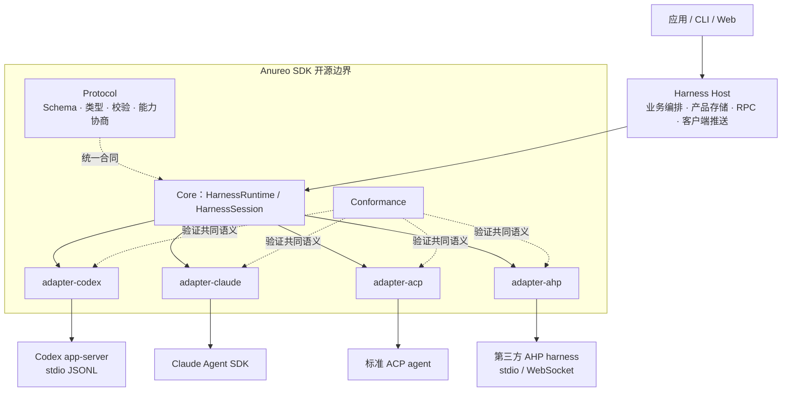

# Anureo SDK 架构

> 状态：**独立开发 workspace 架构说明**（2026-10-29）
> 依据：从 cowork 迁入的七包实现；落地范围和验收证据见[开发与迁移记录](development.md)。
> 关联：[抽取方案](../extraction-plan.md)、[项目入口](../README.md)。
> 本仓源码已使用 AHP 和 `@anureo/*`；上游仍保留 CHP 和 `@cowork/harness-*`。快照迁入与本地改名已经落地，Git 历史迁移、上游切换和公开发布仍待完成。

## 1. 定位与当前状态

Anureo SDK 为 Host 提供统一的 harness 接入接口：协议定义语义，Core 管理运行时，适配器连接不同后端，Conformance 验证共同的行为合同。

Host 可以使用同一套 session、turn、item、事件和交互模型连接 Codex、Claude、ACP agent 或外部 AHP harness。各后端仍负责自己的 agent 执行流程；SDK 负责通信、语义转换和运行时约束。

当前 `anureo-sdk` 包含独立七包 workspace 和验证脚本，源码来自 cowork 的 `packages/harness-sdk/` 快照。下文的包名不代表已有可安装的公开 npm 版本；本轮尚未执行 Git 历史抽取。

## 2. 分层与开源边界



图中的实线表达运行时调用方向。Core 调用注入的适配器，不表示 Core 包依赖具体适配器包。

| 层 | 职责 | 边界 |
|---|---|---|
| Protocol | 会话、执行、内容、事件、交互与能力的统一合同 | 不包含 Host 业务模型 |
| SDK Core + adapters | 接口、运行时约束、后端通信和语义映射 | 不依赖 cowork 的业务包 |
| Harness Host | RPC、产品会话存储、业务编排、客户端事件推送 | 留在 cowork，不随 SDK 抽取 |

其他产品可以实现自己的 Host。cowork 的 `hx.*` RPC 是该产品对客户端的接口，不是 AHP 的线协议。产品会话存储由 Host 管理；适配器可以保留后端接入所需的自身状态，例如 Claude 的 `store.ts`。

## 3. 七包职责与依赖方向

| 当前源码目录 | 目标包名 | 职责 |
|---|---|---|
| `protocol` | `@anureo/protocol` | JSON Schema、生成类型、请求/结果/事件校验、版本和能力检查 |
| `core` | `@anureo/sdk` | 统一 API、生命周期、事件队列、交互管理、错误与脱敏 |
| `codex` | `@anureo/adapter-codex` | 对接 Codex app-server，转换其原生请求与事件 |
| `claude` | `@anureo/adapter-claude` | 对接官方 Claude Agent SDK，转换消息与权限交互 |
| `acp` | `@anureo/adapter-acp` | 对接标准 ACP agent，按能力与显式扩展提供功能 |
| `ahp` | `@anureo/adapter-ahp` | 通过 stdio 或 WebSocket 接入外部同协议 harness |
| `conformance` | `@anureo/conformance` | 共享场景、测试驱动和脚本化后端夹具 |

包依赖方向如下；箭头表示“依赖”：

```text
core ───────────────────→ protocol
codex / claude / acp / ahp → core + protocol
conformance ────────────→ core + protocol
Host ───────────────────→ core + 所选适配器及所需协议类型
```

具体适配器互不依赖，Core 不导入具体适配器。Protocol 当前以 `schema/v1/ahp.schema.json` 为合同来源，通过生成脚本产生 TypeScript 类型，并用 AJV 在运行时校验数据。当前 Claude 和 ACP 适配器分别直接使用相应的官方 SDK。

## 4. Core 的接口与控制责任

对上与对下的接口定义集中在 `core/src/ports.ts`：

| 接口 | 使用者 | 关键操作 |
|---|---|---|
| `HarnessRuntime` | Host | `initialize()`、`openSession()`、`dispose()` |
| `HarnessSession` | Host | `startTurn()`、`events()`、`respond()`、`interrupt()`、`close()` |
| `HarnessAdapter` | Core | `initialize()`、`openSession()`、`dispose()` |
| `BackendSession` | Core | `binding`、`capabilities`、`execute()`、`dispose()` |
| `SessionEventSink` | Adapter | `emit()`、`tryEmit()`、`requestInteraction()`、`resolveInteraction()`、`fail()` |

Host 先构造适配器，再交给 `createHarnessRuntime(adapter, options)`。Runtime 初始化协议和能力、打开会话，并返回统一的 `HarnessSession`。

会话接口还包含 `steer()`、`cancelInteraction()`、`setConfig()`、`revert()`、`readHistory()`、`setGoal()`、`clearGoal()`、`compact()` 和 `review()`。接口存在不代表后端一定支持，调用必须满足协商后的能力和当前状态。

`ManagedHarnessSession` 统一执行以下约束：

- 校验请求、结果、会话绑定与能力，管理 turn 和 item 的生命周期。
- 为事件赋予 `streamId`、`seq` 和时间戳，通过有界队列交给消费者。
- 注册交互、处理回答与取消，并在超时、turn 结束或连接丢失时清理待处理交互。
- 处理请求缓存、等待超时、错误和恢复状态，统一处理已标记 secret 的脱敏。

会话绑定固定的适配器与运行配置；恢复或 fork 必须遵守绑定约束，不支持在同一会话中切换后端。

## 5. 一次 turn 与审批流程

```mermaid
sequenceDiagram
    participant U as 用户 / 客户端
    participant H as Host
    participant C as Core / HarnessSession
    participant A as Adapter
    participant B as 后端 harness
    U->>H: 提交输入
    H->>C: startTurn(params)
    C->>C: 校验参数、能力、绑定和状态
    C->>A: BackendSession.execute(turn/start)
    A->>B: 原生请求
    B-->>A: 原生消息
    A->>C: SessionEventSink.emit(...)
    C-->>H: events(): turn/started、item/*
    H-->>U: 保存并展示输出
    opt 后端请求审批
        B->>A: 原生权限请求
        A->>C: requestInteraction(request, responder)
        C-->>H: interaction/requested
        H-->>U: 展示审批选项
        U->>H: 提交选择
        H->>C: respond(params)
        C->>A: 调用原生 responder
        A->>B: 原生审批回答
        C-->>H: interaction/resolved
    end
    B-->>A: 执行终态
    A->>C: emit(turn/completed)
    C-->>H: turn/completed
    H-->>U: 展示终态
```



事件从适配器进入 `SessionEventSink`，经 Core 校验、脱敏和排队后，由 Host 消费 `session.events()` 返回的 `AsyncIterable`。Host 应及时消费事件；不能等整轮执行结束后才开始排空有界队列。

审批语义与展示策略分离：SDK 管理交互生命周期，Host 负责将选项交给用户并提交有效回答。调用等待的取消与后端执行的中断也是两种操作；需要停止后端执行时，应按能力显式调用 `interrupt()`。

## 6. 能力、版本与扩展

初始化协商协议版本和能力，会话暴露自己的 `capabilities`。未声明的可选能力视为不支持，Core 会在操作前检查。fork、revert、steer、history、goal 等不能仅因为统一接口存在就对外宣称可用。

后端版本和原生协议决定适配器的能力映射。例如 Codex 对未经验证的版本收紧可选能力；Claude 的文件回退需要满足 checkpoint 条件；ACP agent 缺少相关扩展时关闭对应能力。

扩展使用 `x-<vendor>/<feature>` 名称和独立版本，协商后才启用。本仓已将 `x-cowork/` 改为 `x-anureo/`，上游仍使用旧前缀；两端必须采用一致的扩展名称。AHP 的整数协议主版本与 SDK 包的 0.x semver 分别管理。

AHP 关注 Host 与 harness 之间的语义；MCP 关注工具和资源接入。ACP agent 可以通过 ACP 适配器接入本架构，工具调用也可以在统一 item 流中表达。

## 7. 事件、错误与安全边界

| 维度 | 当前设计约束 |
|---|---|
| 事件身份 | 事件包含会话与源流身份及序号；不能将不同 `streamId` 的序号当作同一条永久日志 |
| 生命周期 | Core 检查 turn/item 状态转换，拒绝不符合当前状态的事件或操作 |
| 背压 | 有界队列限制材料和等待者；不可暂停的来源通过 `tryEmit()` 接收失败反馈，不能无限堆积 |
| 请求缓存 | 会话内按方法和 requestId 缓存请求，参数冲突报错；不承诺跨进程全局幂等 |
| 超时与取消 | 请求已发出后停止等待可能得到 `outcomeUnknown`，不代表后端没有执行或已被中断 |
| 故障恢复 | 流失败显式暴露失败或恢复所需状态，不能静默切换后端继续原会话 |
| 脱敏 | 对已标记 secret 进行事件、历史与文件变更材料的相应投影和脱敏；不是任意秘密的自动识别器 |
| 权限 | ACP 的 fs/terminal 能力只在 Host 注入对应 port 时声明，接入适配器本身不自动授予权限 |

Host 的持久事件补读与后端提供方的源流 replay 是不同机制。SDK 不要求所有后端保存完整 delta；提供方 replay 必须通过显式版本扩展协商，不能由 Host 落库能力推导出来。

## 8. 一致性与分发验证

Conformance 通过公共接口驱动各适配器。当前共享场景包括 lifecycle、immediate、identity、approval、userInput、elicitation、dynamicTool、interrupt、steer、fork、revert、history、unknown-item、disconnect 和 backpressure。

每个场景返回 `passed`、`failed` 或 `not-applicable`。可选能力未声明时相应场景可不适用；已声明能力必须被实际覆盖，缺少对应夹具不能当作通过。共享场景是验收范围，不能据此推定协议的每项能力都有完整认证覆盖。

上游 `scripts/harness-sdk/pack.ts --verify` 另行检查独立分发：

- 七包构建为 Node ESM 与 TypeScript 声明，内部 workspace 依赖转换为精确版本。
- 在干净目录用 npm 安装 tgz，检查无 workspace 链接、残留业务包依赖或仓库绝对路径。
- 执行 strict NodeNext 类型检查、Node/Bun 协议校验和共享 conformance 样例。
- 执行标准 ACP agent 与 CHP reference harness 的真实 stdio 对话、审批和中断流程。

上游分发文档记录 macOS、Node 22.20.0、Bun 1.3.6 的历史证据；本仓的当前验收结果另见[开发与迁移记录](development.md#4-验收记录)。脚本化后端和干净安装通过，不等于真实账号、付费模型或所有后端版本已验收。

## 9. 独立仓库目标与迁移状态

本仓保留七包边界，将 `packages/harness-sdk/<leaf>` 提升为 `packages/<leaf>`，同时迁入必要分发脚本。当前结构如下：

```text
anureo-sdk/
├── README.md
├── extraction-plan.md
├── docs/architecture.md
├── packages/
│   ├── protocol/
│   ├── core/
│   ├── conformance/
│   ├── codex/
│   ├── claude/
│   ├── acp/
│   └── ahp/
└── scripts/harness-sdk/  # 打包、npm 解析器和独立验证夹具
```

原方案安排先在 cowork 内改名再抽取。本轮因上游存在进行中的业务改动，先在独立目录迁入快照、改名并配置三平台 CI；上游保持原样。Git 历史迁移、实际远端 CI、dev channel 和公开发布继续按后续验收推进。cowork 最终作为普通下游消费发布包；`packages/server/harness-host` 及其他业务代码继续留在原仓库。

许可证、首发版本和仓库归属仍以[抽取方案 §9](../extraction-plan.md#9-待拍板项p0-清单)为待拍板事项。本地包版本与命名用于开发，不代表已经执行公开发布计划。

## 10. 上游源码索引

以下均为 **cowork 仓库内路径**，供核对当前实现。完成抽取后应更新为独立仓库中的对应路径。

| 路径 | 内容 |
|---|---|
| `packages/harness-sdk/protocol/schema/v1/chp.schema.json` | 当前协议 Schema |
| `packages/harness-sdk/protocol/src/index.ts` | 校验、版本协商与能力检查 |
| `packages/harness-sdk/protocol/scripts/generate.ts` | 类型生成入口 |
| `packages/harness-sdk/core/src/ports.ts` | Host 与 Adapter 两侧接口 |
| `packages/harness-sdk/core/src/runtime.ts` | Runtime 与受管 Session 实现 |
| `packages/harness-sdk/core/src/{queue,interactions,errors,secrets}.ts` | 背压、交互、错误与脱敏组件 |
| `packages/harness-sdk/{codex,claude,acp,chp}/src/index.ts` | 四类适配器入口 |
| `packages/harness-sdk/conformance/src/suite.ts` | 共享一致性场景与结果 |
| `scripts/harness-sdk/pack.ts` | 独立打包与干净安装验收 |
| `docs/harness-protocol.md` | 当前协议规范 |
| `docs/harness-sdk-distribution.md` | 分发方式、验收范围与证据边界 |
